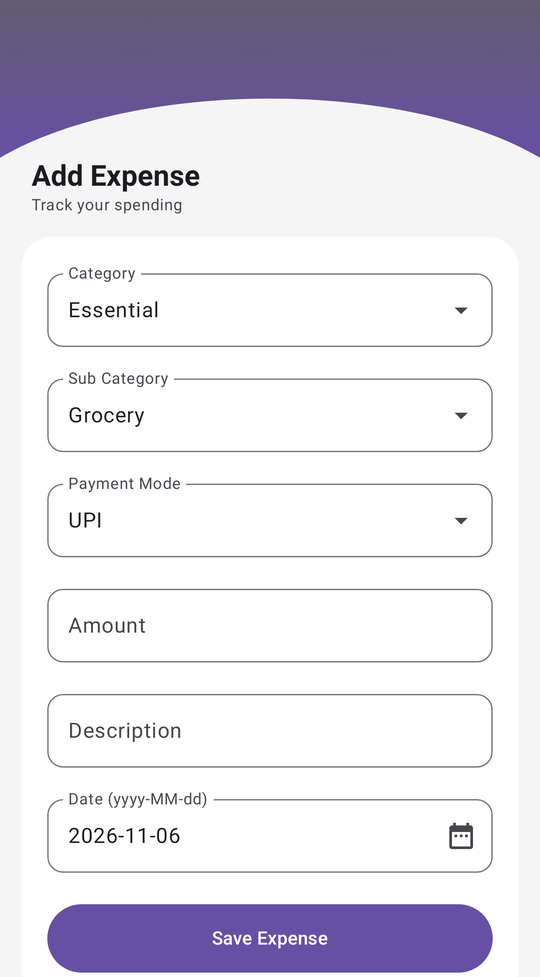
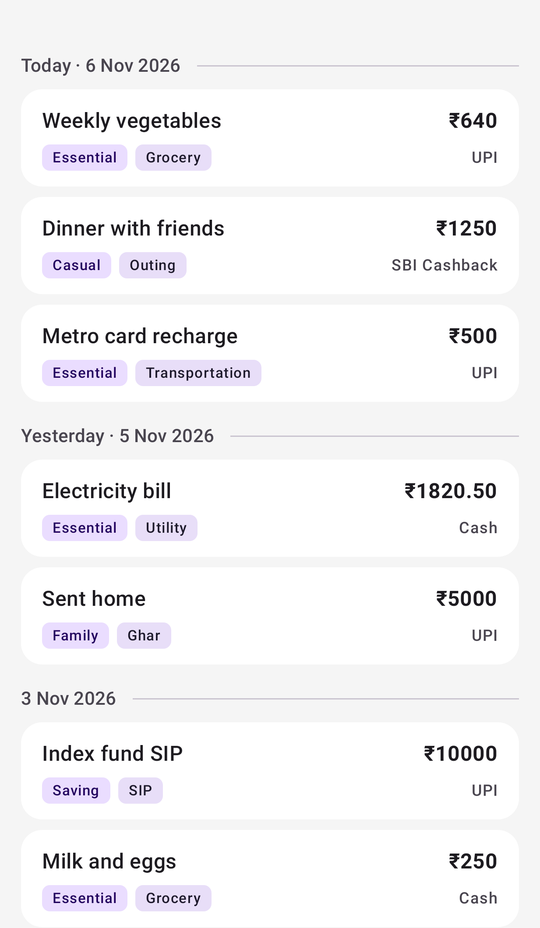
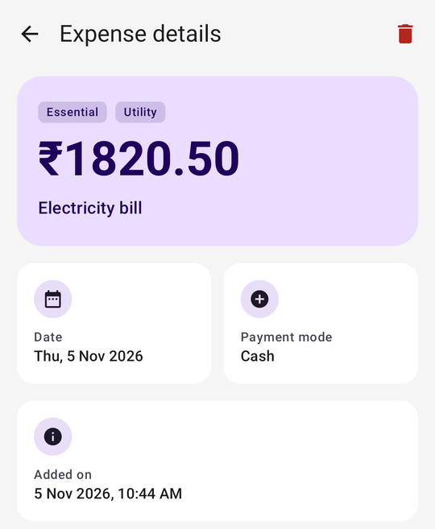
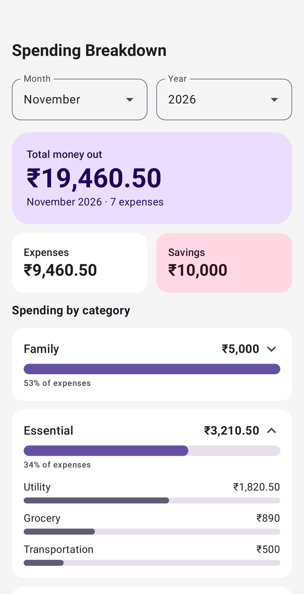
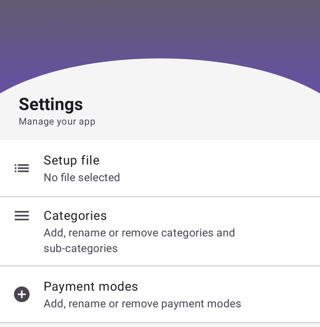
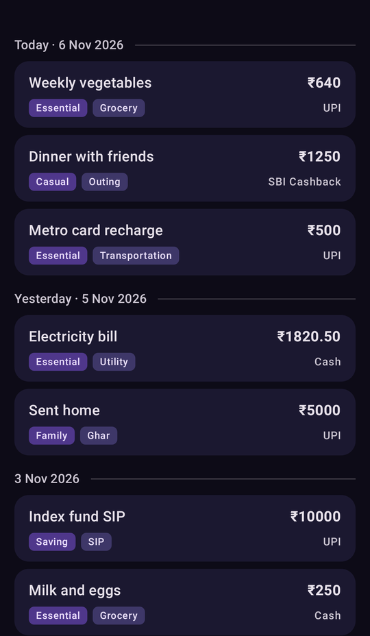
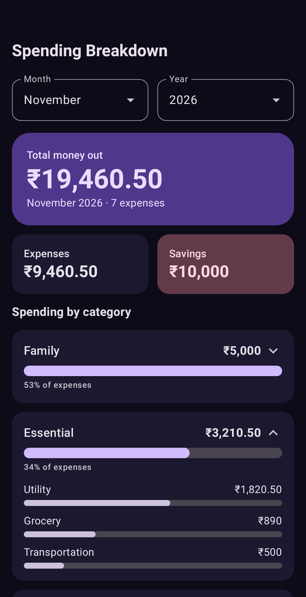

# Expense Tracker

A simple Android app to save your expenses in a CSV file.

- **Free to use**, **completely open source**, and **no ads**.
- No account, no sign-up, no backend, no internet access. Your data is a plain CSV file that you
  own and can open in any spreadsheet app.

## Screenshots

<p>
  
  
  
  
  
</p>

Light and dark themes follow your phone's setting:

<p>
  
  
</p>

_The screenshots show sample data._

## First-time setup: choose your expenses file

The app has to know where to keep your expenses, so **before adding anything, set up the file once**:

1. Open the **Settings** tab.
2. Tap **Setup file**.
3. Choose **New File** to create a fresh `expenses.csv` (pick where to save it), or
   **Existing** to use a CSV you already have.

That's it. The chosen file is remembered, and its name is shown under "Setup file". You can change
it any time the same way.

## What it does

- **Add Expense**: amount, description, date, category, sub-category and payment mode.
- **Expenses**: your expenses grouped by day, one card each, with the category and sub-category as
  tags. Search by description (the default), category, sub-category, amount, payment mode or date. Tap a card for the
  full details, and delete it from there.
- **Overview**: pick a month and see the total money out, split into **expenses** and **savings**,
  with a bar per category. Tap a category to see its sub-categories.
- **Settings**: add, rename and delete your own categories, sub-categories and payment modes, and
  mark a category as **saving** (SIP, FD, ...) so the Overview counts it as savings instead of
  expenses.

## The CSV file

Each expense is one row:

```
Date-Added, Category, Sub-Category, Description, Amount, PaymentMode, Date
```

Names and descriptions can't contain commas, quotes or line breaks, because the file is read as
plain comma-separated text.

## Build it yourself

Requires Android Studio (or a JDK 17+ and the Android SDK).

```bash
./gradlew assembleDebug        # debug APK: app/build/outputs/apk/debug/
./gradlew testDebugUnitTest    # unit tests
```

The app is written in Kotlin with Jetpack Compose and Material 3. It needs Android 8.0 (API 26) or
newer.
